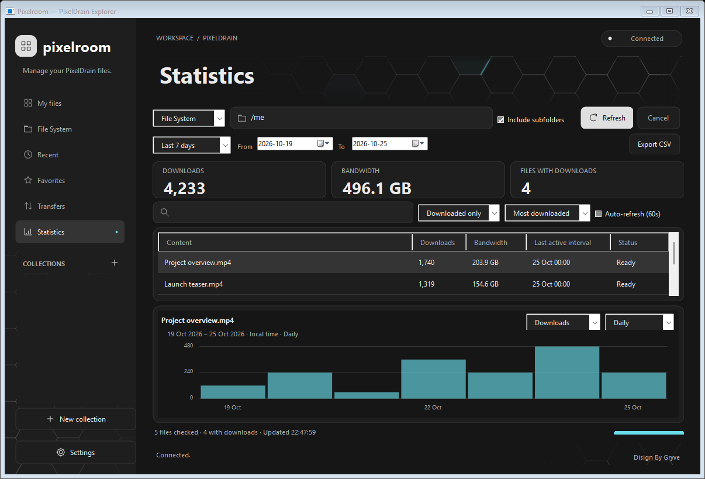

# Pixelroom

A native Windows file manager for PixelDrain, built with C# and Windows Forms.

Manage files, upload folders, download content, create share links, and explore download statistics using your PixelDrain API key.

**Current version: 1.8.0 · Windows x86 and x64 · .NET Framework 4.8**



*The screenshot uses demonstration data. The application starts without sample files.*

## Features

- File System browsing inside one window, with search, date filters, sorting, and sharing indicators.
- Multi-file and multi-folder uploads, including drag and drop and empty subfolders.
- File downloads and folder ZIP downloads, with transfer progress, speed, and cancellation.
- Checkbox selection for copying, moving, downloading, deleting, and sharing several items.
- Public links and hotlinks, including detection of existing links created on the PixelDrain website.
- Statistics with date ranges, per-file download and bandwidth charts, ranking, search, and CSV export.
- Gray and Dark themes with a static honeycomb accent.
- Optional saved API key encrypted with Windows DPAPI for the current Windows user.

Pixelroom is an independent client and is not affiliated with PixelDrain.

## Getting started

1. Build the application using the instructions below, or use a portable release when one is available.
2. Keep `Pixelroom.exe.config` beside `Pixelroom.exe` and open the application.
3. Open **Settings**, enter your PixelDrain API key, and choose **Connect**.
4. Choose **My files**, **File System**, **Transfers**, or **Statistics** from the sidebar.

Personal File System access depends on your PixelDrain subscription and API key permissions. See the [PixelDrain filesystem guide](https://docs.pixeldrain.com/filesystem/).

The [user guide](README.txt) covers the available controls, keyboard shortcuts, sharing behavior, and statistics.

## Important behavior

- **My files display names are local aliases.** Changing a display name does not rename the original file on PixelDrain.
- **Collections are local to this computer.** They are not yet synchronized with PixelDrain account lists or albums.
- **File System renaming and moving use the server API.** Those changes are reflected in the PixelDrain account.
- **Date-filtered statistics are available for File System files.** My files shows lifetime totals because per-file dated history is not available through the API used by this client.
- Cancelled or failed batches can leave earlier items completed. Refresh the destination before retrying.

## Build from source

Requirements: Windows, .NET Framework 4.8, and PowerShell. The build uses the C# compiler included with .NET Framework and does not download third-party packages.

```powershell
.\build.ps1
```

The application is written to `build\Pixelroom.exe`. The same AnyCPU executable supports 32-bit and 64-bit Windows. An MSBuild project is also included as `Pixelroom.csproj`.

## Run the tests

```powershell
.\test.ps1
```

The suite runs in both 64-bit and 32-bit processes. Version 1.8.0 has 150 checks covering API behavior, credentials, file operations, sharing, statistics, selection, and the single-window interface.

Default tests use an in-memory PixelDrain API fixture and isolated temporary profiles. They do not require a real API key or contact your PixelDrain account. Interface tests create temporary Windows Forms windows, so run them in a Windows environment.

## Project structure

```text
src/                  Application and PixelDrain client
tests/                API fixtures, regression tests, and visual previews
docs/images/          Screenshots using demonstration data
build.ps1             Build the Windows executable
test.ps1              Run the x64 and x86 test suites
Pixelroom.csproj      .NET Framework project
README.txt            User guide
CHANGELOG.md          Release notes
```

## Feedback and updates

Use the repository's **Issues** page for bug reports and feature requests. Include the application version and the affected page; remove API keys, personal file links, and other private information from screenshots and logs.

See [CHANGELOG.md](CHANGELOG.md) for version notes and [CONTRIBUTING.md](CONTRIBUTING.md) for development guidance.
